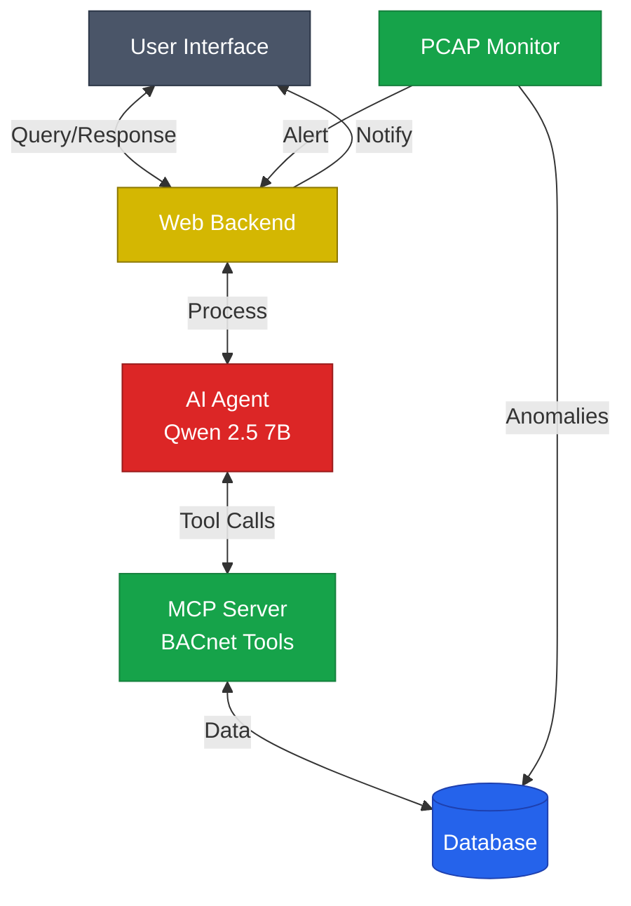
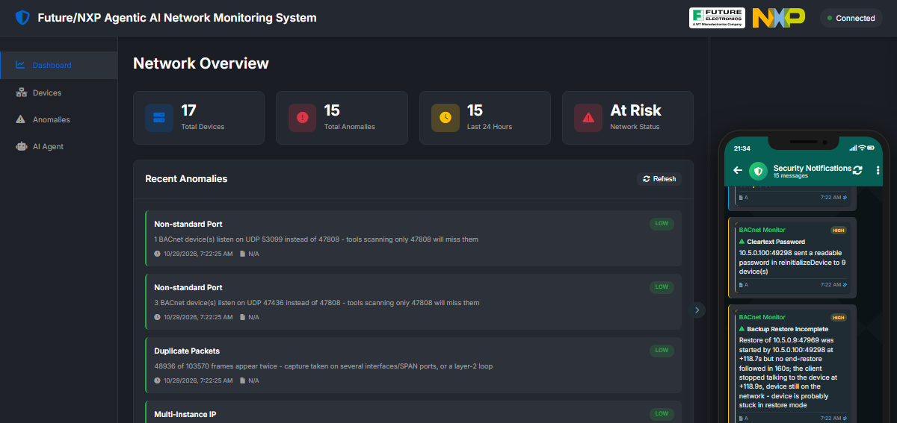

# NXP Application Code Hub
[](https://www.nxp.com)

## i.MX 8M Plus / 95 - Ara240 Agentic Network Management System 

<!----- Boards ----->

[](https://www.nxp.com/FRDM-IMX95) 
[](https://www.nxp.com/FRDM-IMX8MPLUS)
[](https://www.nxp.com/applications/technologies/ai-and-machine-learning:MACHINE-LEARNING)
[](https://mcuxpresso.nxp.com/appcodehub?category=aiml)

[](./LICENSE.txt)
[](https://www.nxp.com/IMXLINUX)

## Introduction
This project demonstrates how to enable an Agent on NXP i.MX edge devices. The demo shows an AI-powered BACnet network management system. The demo combines real-time network monitoring with AI-driven analysis to detect anomalies and provide security insights through natural language interaction.

## Table of Contents
1. [Software](#step1)
2. [Hardware](#step2)
3. [Setup](#step3)
4. [Results](#step4)
5. [FAQs](#step5) 
6. [Support](#step6)
7. [Release Notes](#step7)

## 1. Software<a name="step1"></a>

- Prerequisites
    - [Linux 6.18.2_1.0.0](https://www.nxp.com/IMXLINUX)
    - [Ara Software Development Kit](https://www.nxp.com/design/design-center/software/embedded-software/ara-software-development-kit:ARA-SDK)
    - [eIQ AAF Connector 2.0.0](https://github.com/nxp-imx-support/eiq-aaf-connector)

### 1.1 Software architecture

This demo application adopts the following architecture:

<div align="center">


</div>

### Architecture Components

- **User Interface**: Web dashboard for monitoring and queries
- **Web Backend**: FastAPI server handling requests and WebSocket notifications
- **AI Agent**: Qwen 2.5 7B LLM processing natural language queries
- **MCP Server**: BACnet monitoring tools (devices, anomalies, statistics)
- **PCAP Monitor**: Real-time network traffic analysis and anomaly detection
- **Database**: SQLite storage for devices and anomalies

### Detected BACnet issues

The PCAP monitor decodes BACnet/IP (including BBMD Forwarded-NPDUs), BACnet/Ethernet and MS/TP
(Wireshark link type 165) down to the application layer and reports the issues below. BACnet/IP is
recognised on any UDP port, not only 47808, and captures are streamed so large files fit in memory.

| Area | Anomaly types |
|------|---------------|
| Addressing | `duplicate_ip`, `arp_conflict`, `duplicate_instance`, `multi_instance_ip`, `mac_multi_ip`, `mstp_conflict`, `device_identity_change`, `invalid_device_instance` |
| Transactions | `device_unresponsive`, `request_timeouts`, `file_transfer_failed`, `file_transfer_stalled`, `backup_restore_incomplete`, `backup_restore`, `request_retries`, `slow_response`, `device_busy`, `bacnet_errors`, `bacnet_reject`, `bacnet_abort`, `segmentation_issue` |
| Security | `sensitive_command` (DeviceCommunicationControl, ReinitializeDevice, AtomicWriteFile, Create/DeleteObject, priority 1-2 writes, Initialize-Routing-Table), `access_denied`, `cleartext_password`, `password_bruteforce`, `bbmd_config_change`, `bbmd_reconnaissance`, `foreign_device_registration` |
| Traffic | `broadcast_storm`, `remote_network_load`, `who_is_flood`, `i_am_flood`, `cov_flood`, `service_flood`, `duplicate_broadcast`, `missing_device`, `time_sync_conflict`, `protocol_violation` |
| Network layer | `router_conflict`, `network_number_conflict`, `network_reject`, `router_busy`, `who_is_router_flood`, `unreachable_network`, `routing_loop`, `excessive_hops` |
| Link layer | `bvlc_nak`, `nonstandard_port`, `malformed_packet`, `mstp_crc_error`, `mstp_invalid_master`, `duplicate_packets` |

Each anomaly carries a `recommended_action` in its details. Rate and timing limits are in
`DetectionThresholds` in `bacnet/bacnet_parser.py`. To analyse a capture without the web UI:

```bash
uv run python -m bacnet.bacnet_parser pcap_files/capture.pcap
```

`tests/make_test_pcaps.py <repo> <outdir>` writes synthetic captures that trigger most detectors.

Packet decoding runs in parallel worker processes for captures larger than 4 MB (one worker per
CPU core minus the one running the analysis, i.e. 5 on i.MX 95). Set `BACNET_PARSER_WORKERS` to
change this (`1` disables the pool), or pass `--workers N` to `python -m bacnet.bacnet_parser`.
Ethernet/VLAN/802.3, Linux cooked, raw IP and MS/TP captures are decoded straight from the bytes;
other link types fall back to scapy.

## 2. Hardware<a name="step2"></a>

- i.MX Board
    - [FRDM-IMX95](https://www.nxp.com/FRDM-IMX95)
    - [FRDM-IMX8MPLUS](https://www.nxp.com/FRDM-IMX8MPLUS)
- [Ara 240 Discrete Neural Processing Unit](https://www.nxp.com/ARA240)

## 3. Setup<a name="step3"></a>

- The connector must be running with [Qwen 2.5 Instruct 7B](https://huggingface.co/nxp/Qwen2.5-7B-Instruct-Ara240) prior execution. Follow *eIQ AAF Connector* for more detail instructions.

- PCAP files are not included in the repository. User must capture their own BACnet traffic, create  `pcap_files/` directory and place `.pcap` files in the `pcap_files/` directory for anomaly detection emulation.

***Note:*** Since multiple terminals are needed,  it is suggested to use ssh connections or terminal multiplexer like tmux.

### 3.1 Install `Ara2 Runtime Package` and `eIQ AAF Connector`

Go to [Ara Software Development Kit](https://www.nxp.com/design/design-center/software/embedded-software/ara-software-development-kit:ARA-SDK). And download the `Ara2 Runtime Package` and `eIQ AAF Connector` packages.

On your board:
```bash
date -s <DATE>
dpkg -i rt-sdk-ara2_2.0.4.deb
reboot

dpkg -i eiq-aaf-connector_2.0_all.deb
systemctl disable eiq-aaf-connector.service

source /usr/share/eiq/aaf-connector/venv/bin/activate
connector --host 0.0.0.0 --port 8080
```


### 3.2 Download the model

The model can be download by: 
```
fetch_models --list
Available models:
nxp/Qwen2.5-7B-Instruct-Ara240
nxp/Qwen2.5-Coder-1.5B-Ara240
nxp/Qwen2.5-VL-7B-Instruct-Ara240
$ fetch_models --repo-id nxp/Qwen2.5-7B-Instruct-Ara240
```

### 3.3 Run the eIQ AAF Connector

1. Install the deb package
2. Set model to enable in server configuration file *server_config.json*

    ```
    vi /usr/share/eiq/aaf-connector/server_config.json 
    ```

    Example
    ```
        ...
        {                                
            "name": "Qwen2.5-7B-Instruct",
            "description": "Qwen2.5 7B Instruct Unimodal model",
            "type": "text",
            "tool_calling": "native",
            "max_prompt_size": 2047, 
            "enabled": true
        },
        ...  
    ```

3. Activate the virtual environment
    ```bash
    source /usr/share/eiq/aaf-connector/venv/bin/activate
    ```
4. Run the connector:
    ```bash
    connector --host 0.0.0.0
    ```
5. Wait util connector is complete:
    ```bash
    INFO:     Application startup complete.
    INFO:     Uvicorn running on http://0.0.0.0:8000 (Press CTRL+C to quit)
    ```

### 3.4 Run Agentic Network Management System 

The simplest way is the start script. It waits until the connector reports the model as
ready on the Ara240 (`/v1/models` shows `"ready":true`), then starts the MCP server, waits
for it to listen, and runs the web backend. Ctrl+C stops both:
```bash
cd <project>
uv sync
./start-demo.sh
```
This also works when the connector runs as the `eiq-aaf-connector` systemd service, which
takes a minute or more after boot to load the model. Override the connector address with
`CONNECTOR_URL` (default `http://127.0.0.1:8000`) and the wait limit with `CONNECTOR_TIMEOUT`
(default 600 seconds).

To start the demo automatically at boot, install the two systemd services in `systemd/`
(they assume the project is at `/usr/share/dm-agentic-ai-network-management`; edit the paths
otherwise). Enable the connector service too:
```bash
cp systemd/bacnet-mcp.service systemd/bacnet-backend.service /etc/systemd/system/
systemctl daemon-reload
systemctl enable --now eiq-aaf-connector.service bacnet-mcp.service bacnet-backend.service
```
`bacnet-mcp` starts the MCP server. `bacnet-backend` starts after it and after the
connector, and waits (`start-demo.sh --wait-connector`) until the model is ready before
running the web backend. Follow progress with `journalctl -fu bacnet-backend`, and use
`systemctl restart bacnet-backend` to restart the demo without reloading the model.
Stop the services before running `start-demo.sh` by hand, as both use ports 8080 and 8081.

Or start the parts by hand, once the connector is ready, on another two terminals:
```bash
cd <project>
uv sync
uv run mcp/mcp_server.py
```
```bash
cd <project>
uv run web/backend.py 
```
***Note:*** *uv* is installed at Step 1 when eIQ AAF Connector is installed. If any issue, try installing manually.

#### Live capture (optional)

`bacnet-capture.sh` captures live traffic with Wireshark's `dumpcap` and feeds it to the
demo. It writes to a staging folder (`/var/lib/bacnet-capture`), starts a new file every
5 minutes, and moves each finished file into `pcap_files` as
`capture_<date>_<time>.pcapng`, where the demo analyzes it once. Intervals with no
packets are dropped, and only the newest 24 `capture_*` files are kept (other files in
`pcap_files` are never touched).

Install it as a service; it is not enabled, so it only runs when started:
```bash
cp systemd/bacnet-capture.service /etc/systemd/system/
cp systemd/bacnet-capture.default /etc/default/bacnet-capture
systemctl daemon-reload
systemctl start bacnet-capture       # stop with: systemctl stop bacnet-capture
journalctl -fu bacnet-capture        # one line per finished capture file
```
On stop, the file in progress is moved into `pcap_files` too. To capture at every boot,
`systemctl enable bacnet-capture`.

Settings live in `/etc/default/bacnet-capture` (restart the service after changing them):

| Setting | Default | Meaning |
|---|---|---|
| `CAPTURE_INTERFACE` | `eth0` | Interface to capture on (`dumpcap -D` lists them) |
| `CAPTURE_FILTER` | all UDP, ARP and BACnet/Ethernet | Capture filter; UDP on any port catches BACnet/IP on non-standard ports |
| `ROTATE_SECONDS` | `300` | Seconds per capture file |
| `KEEP_FILES` | `24` | Capture files kept in `pcap_files` |

### 3.5 Access the Web Dashboard

1. Get the IP address of your board:

    ```bash
    $ ifconfig
    ```
2. Open your browser and navigate to:
    ```bash
    http://<board-ip>:8080
    ```
3. Navigate to the dashboard and start querying the AI agent for network management tasks.

## 4. Results<a name="step4"></a>

When the application is launched in a browser, the dashboard is presented as shown below.



## 5. Support<a name="step5"></a>

Questions regarding the content/correctness of this example can be entered as Issues within this GitHub repository.

>**Warning**: For more general technical questions regarding NXP Microcontrollers and the difference in expected functionality, enter your questions on the [NXP Community Forum](https://community.nxp.com/)

[](https://www.youtube.com/NXP_Semiconductors)
[](https://www.linkedin.com/company/nxp-semiconductors)
[](https://www.facebook.com/nxpsemi/)
[](https://x.com/NXP)

## 6. Release Notes<a name="step6"></a>
| Version | Description / Update                           | Date                        |
|:-------:|------------------------------------------------|----------------------------:|
| 1.0     | Initial release on Application Code Hub        | June 29<sup>th</sup> 2026 |

## Licensing

This repository is licensed under the [BSD-3-Clause](./LICENSE.txt) license.
